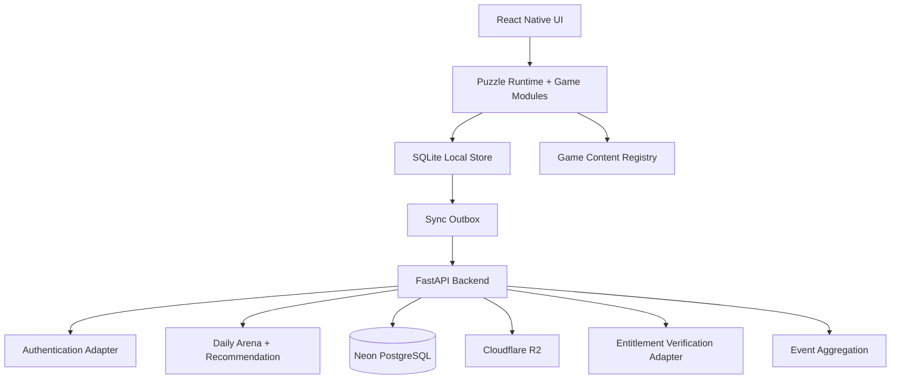

# System Architecture

## 1. High-level topology

## 2. Mobile boundaries
- Presentation: screens, navigation, design tokens and accessibility.
- Domain: game session lifecycle, scoring contracts, progression and recommendations.
- Game modules: isolated rules, state reducers, generators and validators.
- Data: SQLite repositories, content cache and sync outbox.
- Platform adapters: notifications, billing, rewarded ads, secure storage and device capabilities.

Game modules must not directly call the API or write arbitrary database rows. They emit domain events through the runtime.

## 3. Backend boundaries
FastAPI modules:
- `auth`: token verification and guest/account association.
- `profiles`: preferences and consent.
- `catalogue`: game metadata and content versions.
- `sessions`: idempotent session ingestion.
- `progress`: progression snapshots and achievements.
- `arena`: daily recommendation generation.
- `entitlements`: server-side premium status.
- `sync`: cursor-based event reconciliation.
- `admin`: internal content/configuration operations; protected and disabled in public deployments.

## 4. Storage ownership
- SQLite: authoritative local state while offline; pending events.
- Neon: account identity mapping, cloud progress, content metadata, sync receipts and entitlements.
- R2: immutable versioned art/audio/content bundles. Do not store relational records or secrets in R2.
- Render: stateless API process. Do not store user uploads or durable SQLite files on its ephemeral filesystem.

## 5. Offline event model
Each event has:
`event_id`, `profile_id`, `device_id`, `event_type`, `occurred_at`, `game_id`, `game_version`, `payload_version`, `payload`, `sync_status`.

Use UUID event IDs. API ingestion uses unique constraints on `event_id` to make retries idempotent. Store client time and server received time; do not assume device clocks are perfectly accurate.

Conflict policy:
- Completed session events are append-only.
- Personal best is derived from valid event history.
- Cosmetic selection uses last-write-wins with server timestamp.
- Settings use explicit field-level merge.
- Account deletion supersedes pending sync; delete or tombstone per legal policy.
- Never overwrite a higher-quality local completion with a stale server snapshot.

## 6. Recommendation architecture
The recommendation engine is deterministic and explainable:
- Exclude unavailable/locked/uninstalled content.
- Respect session length and user preferences.
- Enforce variety across games/worlds.
- Use game-specific normalised performance and confidence.
- Avoid over-recommending weak performance; balance comfort, novelty and challenge.
- Do not infer clinical ability.
- Return explanation tags such as `variety`, `recent_interest`, `practice_opportunity`, `new_game`.

## 7. Security
- TLS for all API traffic.
- Password/auth handled by a proven provider; never roll custom password storage casually.
- Short-lived access tokens and refresh rotation where supported.
- Secrets only in environment variables/secret manager.
- Rate limit auth, sync and ad reward verification endpoints.
- Validate all payload schemas and sizes.
- Use parameterised SQL/ORM.
- Separate staging and production Neon projects.
- Use least-privilege database credentials.
- Verify billing/ad reward callbacks server-side.
- Redact tokens and personal identifiers from logs.

## 8. API versioning
Prefix routes with `/v1`. Use Pydantic request/response schemas. Return structured errors with stable codes. Document OpenAPI and keep client DTOs aligned.

## 9. Scalability
Start as a modular monolith. Do not split into microservices for a solo project. Add background workers only when analytics/content tasks require them. Cache public game metadata and immutable R2 assets.
