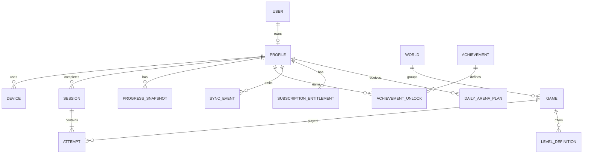

# Database Model (logical)

## Tables and key fields
- `users`: `id`, auth provider subject, email hash/normalised email where needed, created/updated, deletion status.
- `profiles`: `id`, `user_id` nullable for guest, locale, session preference, consent version, created/updated.
- `devices`: `id`, `profile_id`, platform, app version, last sync cursor.
- `worlds`: `id`, slug, title, sort order, content version, availability.
- `games`: `id`, `world_id`, slug, title, mechanic tags, generator type/version, orientation, offline flag, content version.
- `level_definitions`: authored metadata or generator config; avoid storing every endless generated level centrally.
- `sessions`: `id`, `profile_id`, started/ended, mode, app version, sync source.
- `attempts`: `id`, `session_id`, `game_id`, level seed, generator version, difficulty, score, completion, moves, hints, duration, result hash.
- `progress_snapshots`: derived personal best, current band, last played and version.
- `sync_events`: unique `event_id`, `profile_id`, event type, payload version, payload JSONB, client time, received time.
- `achievements`: definitions and version.
- `achievement_unlocks`: profile, achievement, unlocked timestamp.
- `daily_arena_plans`: profile, date, selected game IDs, rationale tags, algorithm version.
- `subscription_entitlements`: profile, product ID, state, valid until, provider token reference (never raw purchase token in analytics).
- `ad_reward_receipts`: provider transaction ID, reward type, profile, verification state; unique transaction ID.

## Data minimisation
Do not collect date of birth unless a concrete policy/legal need emerges. Audience is 18+, so use a neutral adult confirmation flow if needed. Do not collect precise location, contacts or health data. Avoid storing free-form personal notes.
